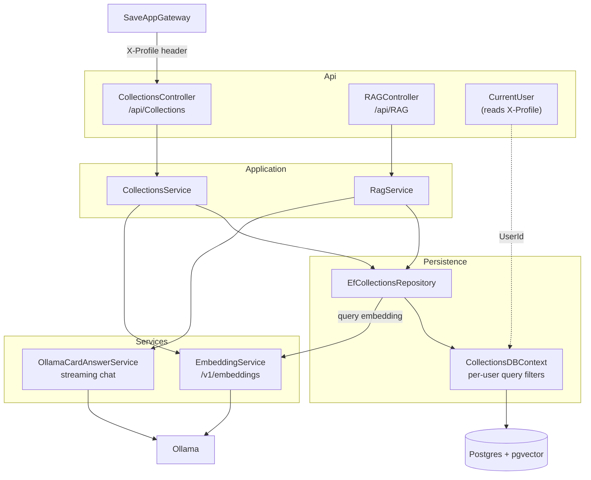
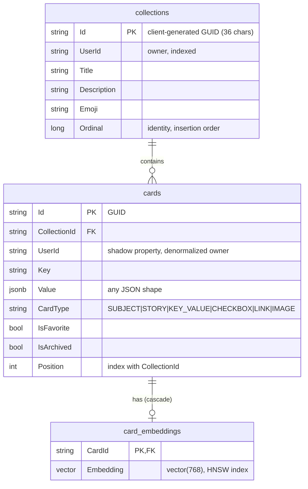
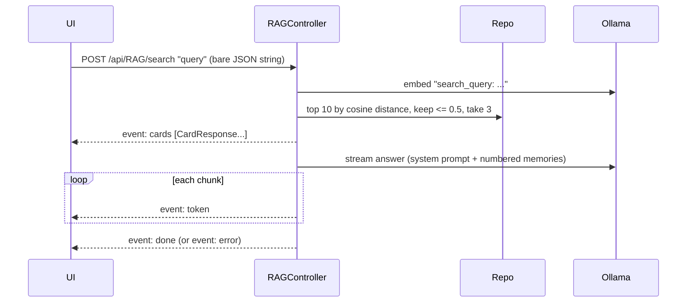

# CollectionsDB (CollectionsService)

The ASP.NET Core 10 backend. It stores users' collections and cards in Postgres, embeds each card with pgvector, and answers chat questions with RAG through a local Ollama model.

## Architecture



Layers: **Api** (controllers, DTO contracts, `CollectionMapper`), then **Application** (use cases), then **Persistence** (EF Core). The `Services/` layer wraps the AI calls.

## Data model



- **Multi-tenancy.** Global query filters on all three tables restrict every query to `ICurrentUser.UserId`. `SaveChanges` stamps the owner on new rows. Repositories never filter by user.
- **Embeddings** are kept in a separate table, so ordinary reads don't load the vectors. The embedded text is `"{Key}: {Value}"`. If embedding fails, the error is logged and the card is still saved without a vector.
- Migrations are in `Persistence/Migrations` and run automatically at startup.

## RAG flow



## API

| Method | Route | Notes |
|---|---|---|
| GET | `/api/Collections` | The current user's collections, including their cards. |
| GET / PUT / DELETE | `/api/Collections/{id}` | `id` must be 36 characters. PUT creates the collection if it is missing (upsert). |
| POST | `/api/Collections` | Create a collection. The client supplies the `id`. |
| POST / PUT / DELETE | `/api/Collections/{id}/Cards` | DELETE takes the body `{ cardId }`. |
| POST | `/api/Collections/inbox` | Used by the Android share sheet. `{ text, type: "link"\|"any", key? }` goes into the fixed inbox collection. |
| POST | `/api/RAG/search` | Server-sent events (SSE) stream, see above. |

Calling the API directly needs an `X-Profile: {"id":"…","name":"…"}` header. Without it, DB access throws `Unauthorized`.

## Run

```bash
dotnet run                     # Swagger at /swagger (Development)
dotnet tool restore && dotnet ef migrations add <Name> -o Persistence/Migrations
```

Configuration: `CollectionsDB:ConnectionString`, `Embedding:Endpoint|Model`, `Llm:OllamaEndpoint|Model`. Aspire sets these as environment variables.
