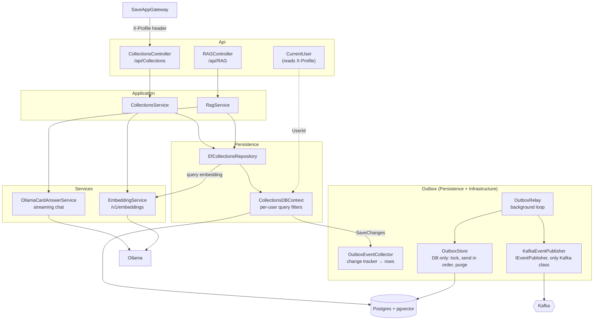
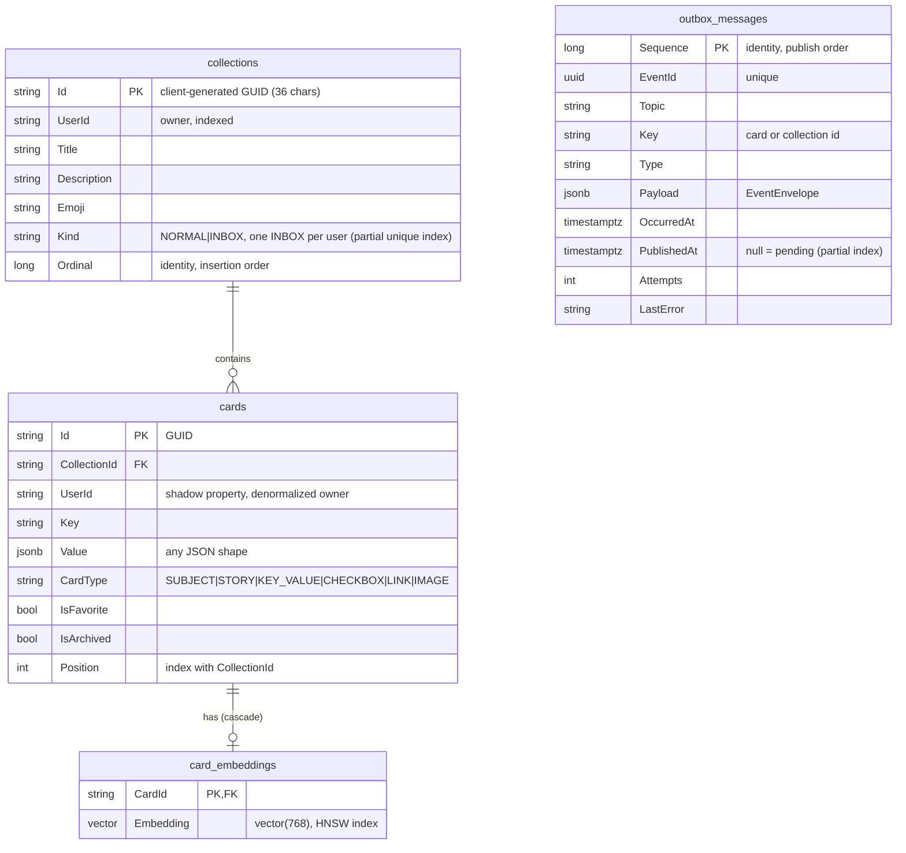
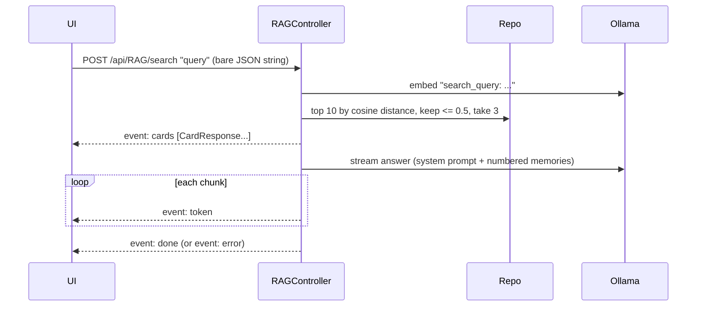

# CollectionsDB (CollectionsService)

The ASP.NET Core 10 backend. It stores users' collections and cards in Postgres, embeds each card with pgvector, and answers chat questions with RAG through a local Ollama model.

## Architecture



Layers: **Api** (controllers, DTO contracts, `CollectionMapper`), then **Application** (use cases), then **Persistence** (EF Core). The `Services/` layer wraps the AI calls. **Infrastructure** holds the background jobs and the Kafka producer.

## Data model



- **Multi-tenancy.** Global query filters on all three tables restrict every query to `ICurrentUser.UserId`. `SaveChanges` stamps the owner on new rows. Repositories never filter by user.
- **Background work.** `CurrentUser` also implements `IUserContext`. Code without an HTTP request (future Kafka consumers) creates a DI scope and calls `Set(userId)`, so the same query filters apply.
- **Inbox.** Each user has one inbox (`Kind = INBOX`). Its ID is a deterministic UUIDv5 of the user ID (`Domain/Collections/InboxId.cs`). `EnsureInboxAsync` creates it on `GET /api/Collections` and `POST inbox`. The first time it runs, it adopts the cards of the old shared inbox `inbox000…` if this user owned it. The inbox is returned first and can't be deleted (DELETE is a no-op returning 204, so the client outbox doesn't get stuck). The `Kind` value sent by the client is ignored.
- **Events (transactional outbox).** Each piece has one job:
  - `Persistence/Outbox/OutboxEventCollector`: inside `SaveChanges`, turns tracked Card/Collection changes into `outbox_messages` rows, in the same transaction. **`ExecuteUpdate`/`ExecuteDelete` skip the change tracker and emit no events**, so use tracked changes for anything consumers must see.
  - `Persistence/Outbox/OutboxStore`: database only. It sends pending rows in order through a callback, under an advisory lock (one active sender), stops at the first failure and records `Attempts`/`LastError`, and purges old rows.
  - `Application/Events/IEventPublisher`: "send this event", with no Kafka types.
  - `Infrastructure/Messaging/KafkaEventPublisher`: the **only** Kafka code. It produces messages (idempotent, `acks=all`, 30 s timeout) and never creates topics; the AppHost does that.
  - `Infrastructure/Outbox/OutboxRelay` (wakes on save or every 2 s) and `OutboxCleanup` (hourly, keeps sent rows for 7 days). Both are configured in the `Outbox` config section.
  - Without `ConnectionStrings:kafka`, the relay isn't registered and the rows wait. Event catalog: [SaveApp.Contracts](../SaveApp.Contracts/README.md).
- **Embeddings** are kept in a separate table, so ordinary reads don't load the vectors. The embedded text is `"{Key}: {Value}"`. If embedding fails, the error is logged and the card is still saved without a vector.
- Migrations are in `Persistence/Migrations` and run automatically at startup.

## RAG flow



## API

| Method | Route | Notes |
|---|---|---|
| GET | `/api/Collections` | The current user's collections with their cards. The inbox comes first, and each collection has a `kind`. |
| GET / PUT / DELETE | `/api/Collections/{id}` | `id` must be 36 characters. PUT creates the collection if it is missing (upsert). |
| POST | `/api/Collections` | Create a collection. The client supplies the `id`. |
| POST / PUT / DELETE | `/api/Collections/{id}/Cards` | DELETE takes the body `{ cardId }`. |
| POST | `/api/Collections/{targetId}/Cards/{cardId}/move` | Moves a card to the end of the target collection. The card keeps its ID and embedding. Idempotent. 404 if the card or the target isn't visible to the user. |
| POST | `/api/Collections/inbox` | Used by the Android share sheet. `{ text, type: "link"\|"any", key? }` goes into the user's inbox, which is created if missing. |
| GET | `/health` | Liveness check used by the AppHost. |
| POST | `/api/RAG/search` | Server-sent events (SSE) stream, see above. |

Calling the API directly needs an `X-Profile: {"id":"…","name":"…"}` header. Without it, DB access throws `Unauthorized`.

## Run

```bash
dotnet run                     # Swagger at /swagger (Development)
dotnet tool restore && dotnet ef migrations add <Name> -o Persistence/Migrations
```

Configuration: `CollectionsDB:ConnectionString`, `Embedding:Endpoint|Model`, `Llm:OllamaEndpoint|Model`. Aspire sets these as environment variables.
