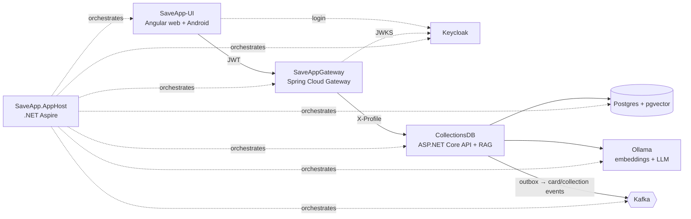

# Welcome to SAVE App!

## Collections UI - main screen
This is the final product the customer will see containing `Collection`s which are list of `Card`s to index all of your memories

## Collections UI - chat bot
This is the chat bot meant for retrieving and querying your memories!

## PROJECTS

| Project | Description |
|---|---|
| [SaveApp-UI](SaveApp-UI/README.md) | Nx/Angular monorepo containing the web and Capacitor Android apps, the local-first sync, and the card-type registries |
| [SaveAppGateway](SaveAppGateway/README.md) | JWT validation, `X-Profile` identity forwarding, and routing `/api/**` |
| [CollectionsDB](CollectionsDB/README.md) | REST API, per-user data model, pgvector embeddings, and the RAG chat stream |
| [SaveApp.Contracts](SaveApp.Contracts/README.md) | Shared Kafka event contracts: envelope, topics, payloads |
| [SaveApp.AppHost](SaveApp.AppHost/README.md) | Aspire orchestration for local development and its configuration |

## DEVELOPMENT
This is the environment which we run the local development using Aspire .NET

## ARCHITECTURE
This is the architecture auto built using Aspire .NET

