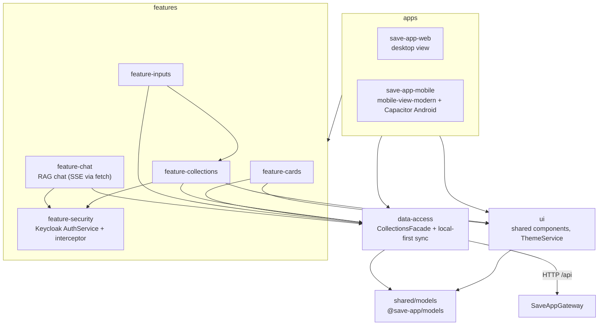
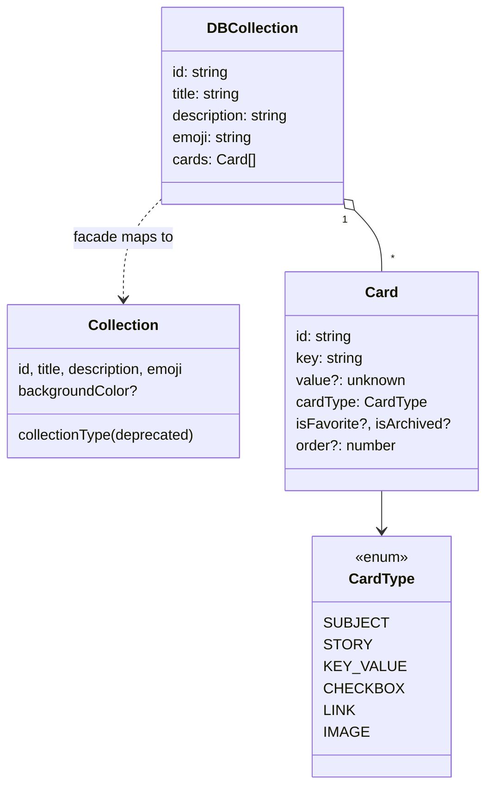
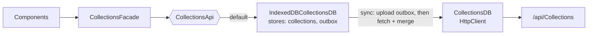

# SaveApp-UI

An Nx 19 / Angular 18 monorepo. It contains the desktop web app and the Capacitor Android app, which share feature libraries.

## Architecture



Both apps use every library. `feature-security` doesn't depend on any other library. Libraries are imported through the `@save-app/*` aliases defined in `tsconfig.base.json`.

## Data models (`libs/shared/models`)



- `DBCollection` has the same shape as the API data. `Collection` is the version used by the UI, without cards.
- `CardType` is sent over the wire as a **number**. Its order must match the backend `CardType` and `CardTypeContract` enums.
- The frontend uses `order` for card order, but the backend uses `position`.

## Card types: registry pattern

Each `CardType` has two components, which are looked up in maps and rendered dynamically:

| Map | Lib | Base class |
|---|---|---|
| `cardToComponentMap` | `feature-cards/registry/card-registry.ts` | `CardBuilderComponent` (displays a card) |
| `inputToComponentMap` | `feature-inputs/registry/input-registry.ts` | `InputBuilderComponent` (creates or edits a card) |

To add a card type: add it to the enum, then add a card component and an input component, register both, and update the backend enums.

## Data access: local-first sync



- Each change is written to IndexedDB **and** added to the `outbox`, so the UI updates immediately.
- A sync runs at startup, after every change, every 5 minutes, when the device comes back online, and when the tab becomes visible. It only runs while `canSync()` is true (the user is authenticated or auth is disabled).
- Sync uploads outbox entries in order and stops at the first failure. It then fetches the server copy and merges: **the server wins, except for collections that still have pending local changes**.
- `cardSynced$` and `hasUnsyncedChanges$` drive the "unsynced" indicators.
- `provideDataAccess(config, { localFirst: false })` switches to calling the HTTP API directly.

## Auth (`feature-security`)

- **Web:** keycloak-js with `check-sso` and PKCE.
- **Native:** the login page opens in the system browser (`@capacitor/browser`) and redirects back to `com.aviv.saveapp:/auth`. Tokens, including the `offline_access` refresh token, are kept in secure storage.
- `authInterceptor` adds `Authorization: Bearer`. `KEYCLOAK_CONFIG.enabled=false` turns auth off.

## Mobile specifics

- Environment: `apps/save-app-mobile/src/environments/environments.ts` (Tailscale host).
- `android/.../ShareReceiverActivity.java` receives `ACTION_SEND` (share sheet) and POSTs the shared text to `/api/Collections/inbox`.

## Commands

```bash
npm install
npx nx serve save-app-web               # auth off, /api -> localhost:8000
npx nx serve save-app-web -c aspire     # auth via Keycloak
npx nx serve save-app-mobile
npx nx test <project>                   # data-access, feature-*, ui
npx nx lint <project>
npx nx build save-app-mobile && (cd apps/save-app-mobile && npx cap sync android)
```
