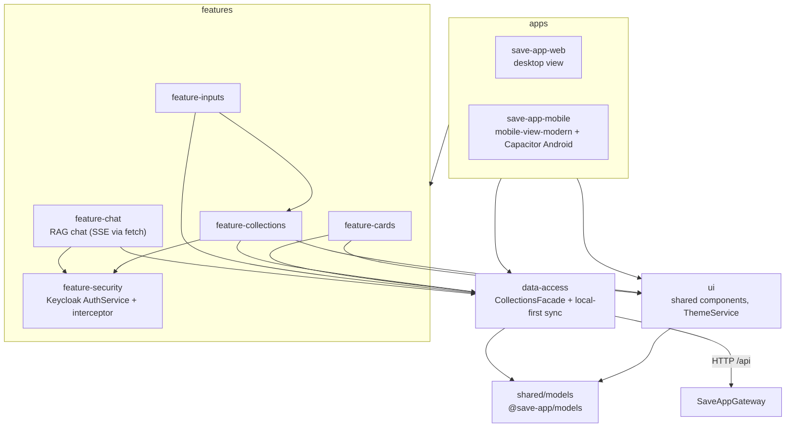
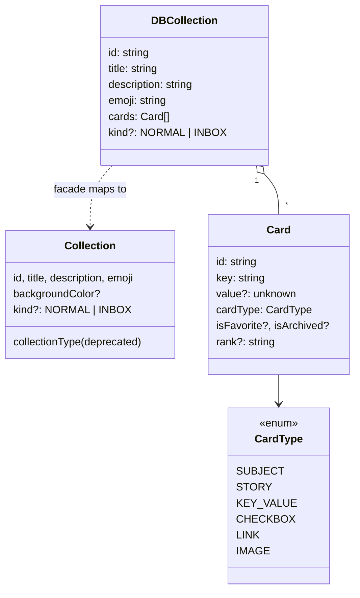
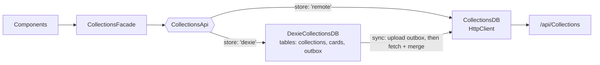

# SaveApp-UI

An Nx 19 / Angular 18 monorepo. It contains the desktop web app and the Capacitor Android app, which share feature libraries.

## Architecture



Both apps use every library. `feature-security` doesn't depend on any other library. Libraries are imported through the `@save-app/*` aliases defined in `tsconfig.base.json`.

## Data models (`libs/shared/models`)



- `DBCollection` has the same shape as the API data. `Collection` is the version used by the UI, without cards.
- `CardType` is sent over the wire as a **number**. Its order must match the backend `CardType` and `CardTypeContract` enums.
- Card order is `rank`, a fractional-index string generated by the `fractional-indexing` package (wrapped in `libs/data-access/src/lib/rank.ts`). Cards sort by `(rank, id)` in code unit order everywhere: Dexie, the server and the UI.

## Card types: registry pattern

Each `CardType` has two components, which are looked up in maps and rendered dynamically:

| Map | Lib | Base class |
|---|---|---|
| `cardToComponentMap` | `feature-cards/registry/card-registry.ts` | `CardBuilderComponent` (displays a card) |
| `inputToComponentMap` | `feature-inputs/registry/input-registry.ts` | `InputBuilderComponent` (creates or edits a card) |

To add a card type: add it to the enum, then add a card component and an input component, register both, and update the backend enums.

## Data access: local-first sync



- The store and all sync options come from `environment.dataAccess` (`store`, `dbName`, `pollIntervalMs`, `unsyncedDebounceMs`, `syncOnOnline`, `syncOnVisible`), passed as `provideDataAccess(config, environment.dataAccess)`. Without a `store`, `provideDataAccess` uses `'dexie'`.
- **`DexieCollectionsDB`** (Dexie 4, `liveQuery`) keeps cards in their own table:

  | Table | Key / indexes | Row |
  |---|---|---|
  | `collections` | `id`, `position` | collection without `cards`, plus `position` (server order) |
  | `cards` | `id`, `collectionId`, `[collectionId+rank]` | `{ id, collectionId, rank, card: Card }` (`rank` copied from `card.rank` for the index) |
  | `outbox` | `++sequence` | queued change |

  The old hand-written IndexedDB store (cards embedded in their collection) was removed, with no migration. Its data lived under the same `dbName`, so clear the browser database on devices that ran it.
  DI tokens let you swap its dependencies: `COLLECTIONS_DEXIE` (the database), `INDEXED_DB` (the IndexedDB implementation, e.g. fake-indexeddb) and `SYNC_TRIGGERS` (the observable that starts background syncs).
- Each change is written to IndexedDB **and** added to the `outbox` in one transaction, so the UI updates immediately.
- A sync runs at startup, after every change, every `pollIntervalMs` (5 minutes), when the device comes back online, and when the tab becomes visible. It only runs while `canSync()` is true (the user is authenticated or auth is disabled).
- Sync uploads outbox entries in order and stops at the first failure. Each server call has a 30 s rxjs `timeout` (`SYNC_REQUEST_TIMEOUT_MS` in `sync-utils.ts`), so a request that never settles can't wedge `syncInProgress`. Failures are logged as `[sync] …` in the console. Because a timed-out change may already be applied, the server's creates are idempotent. It then fetches the server copy and merges: **the server wins, except for collections that still have pending local changes**.
- `moveCard` updates both collections locally in one transaction and queues a single `moveCard` change. Both collections count as locally changed until it syncs.
- **Ordering.** A reorder is a move within the same collection: `reorderCards` gives the dragged card a rank between its new neighbours (`rankBetween`) and queues one `moveCard` change with that `rank`, so only that card is rewritten and shows as unsynced. If the neighbours tie or have no rank, it re-ranks the list and sends a move only for cards whose rank changes. New cards and cards moved into another collection get "after the last rank". The Dexie schema stays at version 1 (no production data): clear the site data on a device that ran the old `position` schema.
  ```mermaid
  sequenceDiagram
      participant V as CardsView (drag)
      participant F as CollectionsFacade
      participant D as DexieCollectionsDB
      participant S as Server
      V->>F: reorderCards(cards, from, to)
      F->>F: rank = rankBetween(prev.rank, next.rank)
      F->>D: moveCard(c, c, cardId, rank)
      D->>D: cards.put(rank) + outbox.add(moveCard) (one transaction)
      D-->>S: POST /{c}/Cards/{cardId}/move { rank } (background sync)
  ```
- The server's inbox (`kind: 'INBOX'`) is pinned first by the facade (`inbox$`), and its delete control is hidden on desktop and mobile.
- `cardSynced$` and `hasUnsyncedChanges$` drive the "unsynced" indicators.
- `store: 'remote'` switches to calling the HTTP API directly.

## Auth (`feature-security`)

- **Web:** keycloak-js with `check-sso` and PKCE.
- **Native:** the login page opens in the system browser (`@capacitor/browser`) and redirects back to `com.aviv.saveapp:/auth`. Tokens, including the `offline_access` refresh token, are kept in secure storage.
- `authInterceptor` adds `Authorization: Bearer`. `KEYCLOAK_CONFIG.enabled=false` turns auth off.

## Mobile specifics

- Environment: `apps/save-app-mobile/src/environments/environments.ts` (Tailscale host).
- **Rule: every data change goes through the Angular app.** Native/Capacitor code never calls the backend itself; it hands data to the Angular app, which saves it via `CollectionsFacade`, so it gets the local store, the outbox (offline), ranks and auth.
- **Share sheet → inbox (offline, no app launch).** The share sheet starts native Java without a WebView, so it can't write to Dexie directly:

  ```mermaid
  sequenceDiagram
    participant S as Share sheet
    participant R as ShareReceiverActivity
    participant Q as ShareQueue (SharedPreferences)
    participant A as ShareInboxService (JS)
    participant F as CollectionsFacade / Dexie outbox
    S->>R: ACTION_SEND text
    R->>Q: add {id, text, type, url?, key?}
    R-->>S: toast "Saved" (no network, no token)
    Note over A: app start (after auth.init) / resume / inbox first known
    A->>Q: ShareInbox.getPending()
    A->>F: createCard(inboxId, draft) — normal insert
    A->>Q: ShareInbox.remove([id])
    F->>F: outbox syncs to the server when signed in + online
  ```

  - `ShareQueue.java` is the hand-off buffer, and `ShareInboxPlugin.java` (`ShareInbox`, registered in `MainActivity`) exposes `getPending()` / `remove(ids)`.
  - `src/app/share/share-inbox.service.ts` turns each item into a normal card: a link becomes `LINK` (key = host, value = URL), anything else becomes `SUBJECT` (key = text). Items wait in the queue until the inbox has been synced once.
  - Items are stored even while signed out. On mobile, `SyncOnLoginService` runs `syncNow()` right after sign-in, so anything queued while signed out uploads immediately.
  - A shared item reaches the server the next time the app opens or resumes. A true background upload (WorkManager) is not built yet.

## Commands

```bash
npm install
npx nx serve save-app-web               # auth off, /api -> localhost:8000
npx nx serve save-app-web -c aspire     # auth via Keycloak
npx nx serve save-app-mobile
npx nx test <project>                   # data-access, feature-*, ui
npx nx lint <project>
npx nx build save-app-mobile && (cd apps/save-app-mobile && npx cap sync android)
```
