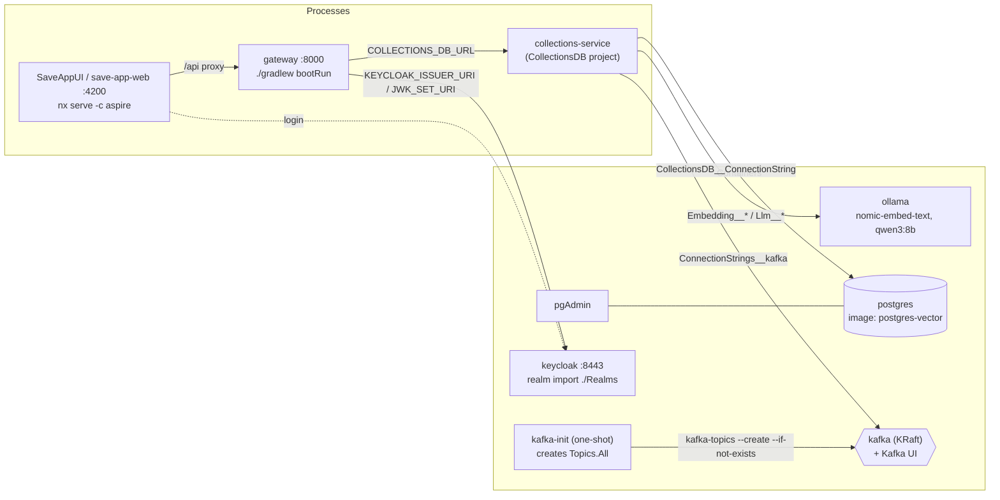

# SaveApp.AppHost

The .NET Aspire orchestrator for local development. One command starts the whole system and wires the services together with connection strings and environment variables.

```bash
aspire run        # from the repo root (aspire.config.json points here)
```

## Architecture



Startup order: `kafka-init` waits for Kafka and creates every topic in `SaveApp.Contracts` `Topics.All` (3 partitions, idempotent). `collections-service` waits for the database and for `kafka-init` to **finish**, and `gateway` waits for Keycloak. Kafka UI (linked in the dashboard) shows the `saveapp.*` topics and their messages.

## Configuration

`appsettings.json` → `App` section:

| Key | Effect |
|---|---|
| `AuthenticationEnabled` | Passed to the gateway as `APP_SECURITY_ENABLED`. |
| `Realm`, `ClientId` | Keycloak realm (`save-app`) and the web client. |
| `KeycloakUrl` / `KeycloakPublicUrl` | Both are accepted token issuers. The public URL is the Tailscale host, which the mobile app uses. |
| `KafkaTopicPartitions` | Optional, default `3`. Partitions per topic, used by `kafka-init`. |
| `IsPersistent` | When `true`, Postgres, Keycloak and Kafka get data volumes. When `false`, all data is lost on restart. |

Topics are infrastructure: services never create them. To add a topic, add it to `Topics.All`. **Keep broker auto-create on.** Aspire's Kafka health check writes to `healthchecks-topic`; with auto-create off, Kafka never becomes healthy and `kafka-init` and every service wait forever. The downside is that a misspelled topic name gets auto-created with 1 partition instead of failing, so check Kafka UI for stray topics.

`Realms/save-app-realm.json` is imported into Keycloak at startup. It defines the `save-app` realm, the public PKCE clients `save-app-ui` and `save-app-mobile`, and their redirect URIs (web origins, `capacitor://localhost`, `com.aviv.saveapp:/…`).

## Prerequisites

- Build the Postgres image: `docker build -f CollectionsDB/Dockerfile.postgres -t postgres-vector CollectionsDB`
- `npm install` in `SaveApp-UI/`. The AppHost runs it with `install: false`, so it won't install for you.
- JDK 25 for the gateway.
