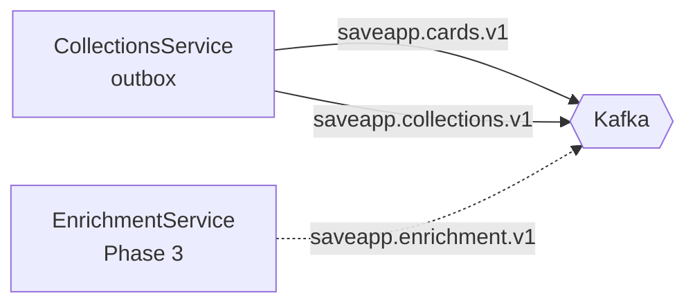

# SaveApp.Contracts

Shared event contracts for the Kafka backbone. Records only, no logic beyond JSON settings and the content hash. Services reference this project, so a producer and its consumers can't drift apart.

## Envelope

Every message on every topic is an `EventEnvelope<T>`, serialized with `EventJson.Options` (camelCase, enums as strings):

```json
{ "eventId": "uuid v7", "type": "CardCreated", "version": 1,
  "occurredAt": "2026-11-17T17:30:00Z", "userId": "<keycloak sub>", "payload": { } }
```

- **Key** = the card ID or the collection ID, so all events of one entity land on one partition, in order.
- **Headers**: `type` and `eventId`, so consumers can filter without parsing the body.
- **Delivery is at-least-once.** Consumers must ignore an `eventId` they've already processed.
- **`userId`** is the owner. Consumers act as that user (`IUserContext.Set`) so the tenant filters still apply.

## Topics and events



| Topic | Type | Payload | Emitted when |
|---|---|---|---|
| `saveapp.cards.v1` | `CardCreated` | `CardUpsertedPayload` | A card is added (directly, through the inbox, or inside a new or upserted collection). |
| | `CardUpdated` | `CardUpsertedPayload` | Type, key, value, favorite or archived changed. **Reordering alone emits nothing.** |
| | `CardMoved` | `CardMovedPayload` | The card's collection changed (move endpoint, legacy-inbox adoption). |
| | `CardDeleted` | `CardDeletedPayload` | The card is deleted, including when its collection is deleted. |
| `saveapp.collections.v1` | `CollectionUpserted` | `CollectionUpsertedPayload` | Created, or title, description, emoji or kind changed. |
| | `CollectionDeleted` | `CollectionDeletedPayload` | Deleted. A `CardDeleted` is also sent for each of its cards. |
| `saveapp.enrichment.v1` | *(Phase 3)* | | |

`CardUpsertedPayload` carries the full card content plus `collectionIsInbox` and `contentHash` (`CardContent.Hash(type, key, value)`). Consumers use the hash to skip expensive work, like the LLM stage, when the content hasn't changed.

## Topic creation

`Topics.All` lists every topic. The AppHost's one-shot `kafka-init` container creates them before any service starts. Services only produce and consume. Broker auto-create stays on, because the Aspire health check needs it (see the AppHost README).

## Versioning

Adding optional fields is fine. A breaking change means a new topic (`*.v2`) and bumping `EventEnvelope.CurrentVersion`.
