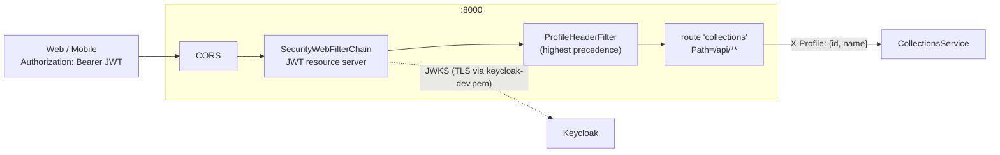

# SaveAppGateway

A Spring Cloud Gateway (WebFlux, Spring Boot 4, Java 25) that sits in front of `CollectionsService`. It checks the Keycloak JWT, forwards the user's identity to the backend, and proxies `/api/**`.

## Architecture



| Component | Responsibility |
|---|---|
| `SecurityConfig` | When `app.security.enabled=true`: requires a valid JWT everywhere except `OPTIONS` and `/actuator/health/**`. Validates the token signature against the JWKS and checks `iss` against `allowed-issuers` (local and Tailscale Keycloak URLs). When disabled: allows all requests, and refuses to start under a `prod`, `production` or `staging` profile. |
| `ProfileHeaderFilter` | Always **removes** any `X-Profile` header sent by the client. For an authenticated request it sets `X-Profile` to `{"id": sub, "name": name or preferred_username}`. The backend trusts only this header. |
| `AuthProperties` | `app.security.*`: `enabled`, `issuer-uri`, `jwk-set-uri`, `trust-bundle`, `allowed-issuers`. |

With security disabled no `X-Profile` is sent, and the backend rejects data access.

## Configuration

| Env var | Purpose |
|---|---|
| `SERVER_PORT` | Port (default 8080; Aspire uses 8000). |
| `COLLECTIONS_DB_URL` | Backend base URL that requests are routed to. |
| `APP_SECURITY_ENABLED` | Turns JWT checks on or off. |
| `KEYCLOAK_ISSUER_URI`, `KEYCLOAK_JWK_SET_URI` | Where JWKS comes from (defaults to `<issuer>/protocol/openid-connect/certs`). |
| `APP_SECURITY_ALLOWED_ISSUERS` | Comma-separated list of accepted `iss` values. |
| `SPRING_PROFILES_ACTIVE=dev` | Loads `application-dev.yml`, which trusts `certs/keycloak-dev.pem` (`KEYCLOAK_DEV_CERT`). |

Allowed CORS origins are listed in **two** places in `application.yml`: `spring.cloud.gateway…globalcors` and `app.cors.allowed-origins`. Keep them in sync.

## Run

```bash
./gradlew bootRun
./gradlew test
```
